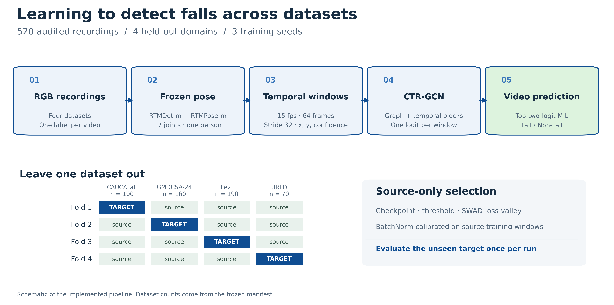
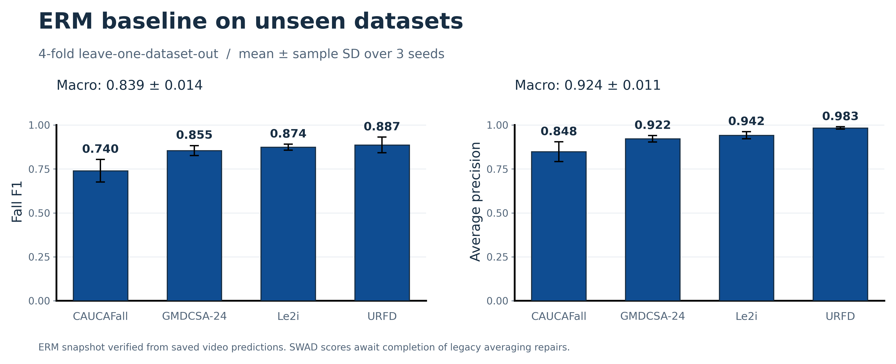
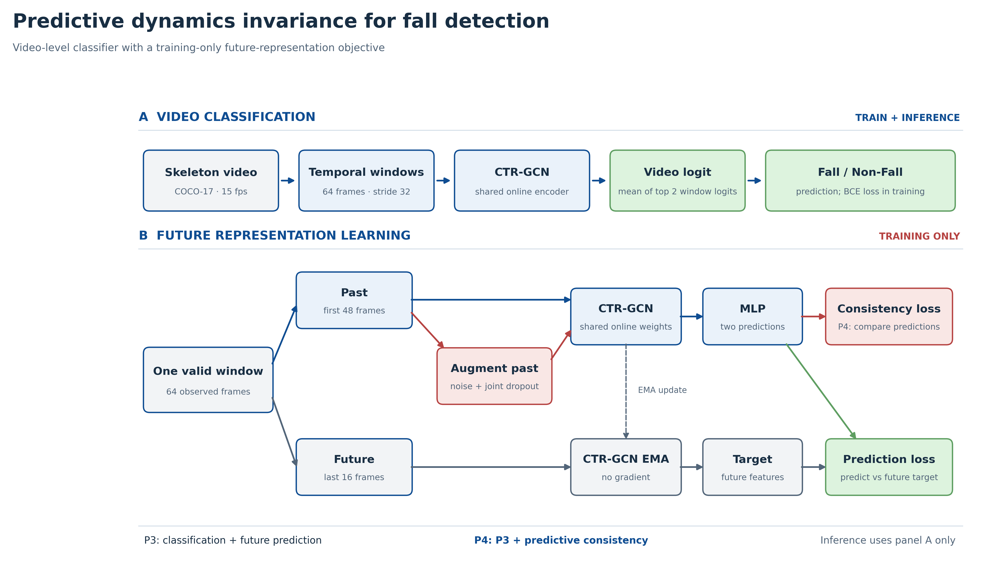

# Cross-Dataset Fall Detection

**Can a fall detector generalize to a dataset it has never seen?**

A reproducible, skeleton-based video classification pipeline built with **PyTorch, RTMPose and CTR-GCN**. It benchmarks Fall / Non-Fall recognition across four datasets using leave-one-dataset-out evaluation, with source-only model selection and an auditable prediction for every held-out recording.




## Project highlights

- **520 audited recordings** from CAUCAFall, GMDCSA-24, Le2i and URFD, with frozen splits and SHA-256 provenance.
- **End-to-end CLI:** acquisition, dataset audit, pose extraction, visual previews, training and evaluation.
- **Temporal graph learning:** a COCO-17, single-person CTR-GCN adaptation with video-level multiple-instance learning (MIL).
- **Cross-dataset evaluation:** four held-out domains × three fixed seeds. Model selection, thresholds and BatchNorm calibration use source data only.
- **ERM and SWAD implementations**, with regression tests for averaging, leakage prevention, deterministic resume and metric aggregation.

## Results

The bundled **ERM baseline** reaches **0.839 macro Fall F1** and **0.924 macro average precision**. These are results from saved real-data experiments, verified against predictions and checkpoint hashes during repository preparation.



| Held-out dataset | Recordings | Fall F1 ↑ | Average precision ↑ |
|---|---:|---:|---:|
| CAUCAFall | 100 | 0.740 ± 0.064 | 0.848 ± 0.056 |
| GMDCSA-24 | 160 | 0.855 ± 0.028 | 0.922 ± 0.018 |
| Le2i | 190 | 0.874 ± 0.017 | 0.942 ± 0.020 |
| URFD | 70 | 0.887 ± 0.044 | 0.983 ± 0.007 |
| **Macro across datasets** | **520** | **0.839 ± 0.014** | **0.924 ± 0.011** |

Values are mean ± sample standard deviation over seeds **42, 123, 2026**. Macro scores give each dataset equal weight within each seed. Average precision is stored as `pr_auc` in the CSVs and computed with `sklearn.metrics.average_precision_score`.

Inspect the [per-seed metrics](benchmarks/erm/metrics.csv), [1,560 video predictions](benchmarks/erm/predictions.csv), [provenance](benchmarks/erm/provenance.json) and [evaluation notes](docs/EVALUATION.md). Checkpoints and raw datasets are excluded from this repository.

**SWAD status:** the implementation includes a version-2 averaging correction. At packaging time, 2 of 12 saved SWAD runs had been repaired. The other 10 and the aggregate report still needed updating, so SWAD scores are excluded from this snapshot.

## E2 paired domain-exposure experiment

E2 adds other recordings from the target dataset to training, then evaluates each held-out video once per seed. All **48 runs** finished with the same optimizer-step budget as the matching E1 runs. Macro Fall F1 rose from **0.839 to 0.930** and average precision from **0.924 to 0.979** across four domains and three seeds. The gains show that target-domain exposure helps under this protocol, but added training data is also a possible contributor. Full local results are in `research/results/e2/REPORT.md`.

| Target dataset | E1 Fall F1 | E2 Fall F1 |
|---|---:|---:|
| CAUCAFall | 0.740 | 0.907 |
| GMDCSA-24 | 0.855 | 0.897 |
| Le2i | 0.874 | 0.926 |
| URFD | 0.887 | 0.989 |

## Research idea

We are testing whether learning to predict **future skeleton motion** helps the fall detector work on unseen datasets. The main CTR-GCN still classifies a whole video from its 64-frame windows. During training, a second branch takes the first 48 frames, predicts a representation of the last 16 frames, and compares it with a slowly updated EMA encoder. It also checks whether the prediction stays similar after small pose noise and joint dropout. **P3** uses future prediction. **P4** adds this consistency check. At inference, only the video classifier runs. It needs neither the prediction branch nor the EMA encoder.



The first paired pilot finished on CAUCAFall with seed 42 and 30 epochs per method. **P4 reached Fall F1 0.745 and AP 0.812**, versus **0.673 and 0.785 for P3**. This is exploratory evidence from one domain and one seed. Its training budget differs from E1's, so it does not establish an improvement over the E1 baseline. Full local results are in `research/results/pdi/paired/caucafall/42/REPORT.md`.

The full P3/P4 comparison runs four target domains and three seeds with each run's optimizer budget matched to E1. Run or resume it with `bash scripts/run_pdi_full.sh`. Logs and the final report go to `research/results/pdi_full/`.

## Quick start

Use **Python 3.11**. The CPU checks below run without downloading datasets, model weights or the pose stack.

```bash
python3.11 -m venv .venv
source .venv/bin/activate
python -m pip install --upgrade pip
# CPU runtime for tests and the synthetic smoke test:
python -m pip install torch==2.9.1 --index-url https://download.pytorch.org/whl/cpu
python -m pip install -r requirements.txt

python run.py --help
OMP_NUM_THREADS=2 MKL_NUM_THREADS=2 python -m pytest -q
python scripts/verify_benchmark.py
OMP_NUM_THREADS=2 MKL_NUM_THREADS=2 python run.py train --smoke-test
```

The smoke test uses synthetic skeletons to check the model and loss path. The reported benchmark above comes from real recordings.

## Test one RGB video

Use a saved ERM checkpoint to run the complete frozen pose and classifier pipeline on one video:

```bash
python run.py predict-video \
  --video /path/to/video.mp4 \
  --checkpoint /path/to/best_erm.pt \
  --device cuda \
  --output /path/to/annotated-result.mp4
```

The optional annotated MP4 shows the tracked person's box, COCO-17 skeleton, predicted class and Fall probability. The JSON output includes the Fall probability, the checkpoint's source-selected threshold, the predicted class, pose coverage and number of temporal windows. For a video from one of the four benchmark datasets, use the checkpoint whose `fold` is that dataset so the model was not trained on it. For a new external domain, report which checkpoint was selected instead of choosing one after looking at the prediction.

## Run the full pipeline

Full experiments additionally require dataset access, sufficient disk space, a CUDA-enabled PyTorch installation and the pose dependencies in [requirements-pose.txt](requirements-pose.txt). The recorded environment used CUDA 12.8. **MMCV requires compiled ops compatible with the installed PyTorch/CUDA stack**. A generic pip installation alone may require building those ops. See the [recorded runtime](benchmarks/erm/environment.json).

Run commands from the repository root. Paths and pinned pose-checkpoint URLs are in [config.yaml](config.yaml).

```bash
# Review sources, then download the versions used by this benchmark.
python run.py download --dataset all --source mirror --dry-run
python run.py download --dataset all --source mirror --resume
python run.py inspect

# Check a small pose sample before extracting all recordings.
python run.py extract --dataset all --limit 2 --device cuda --resume
python run.py preview --dataset all --limit 2
python run.py extract --dataset all --device cuda --resume

# Validate the bundled split against the reconstructed manifest.
python run.py split --seed 2026
python run.py inspect --check-splits

# Each ERM trajectory also produces its paired SWAD checkpoint.
python run.py train --method erm --fold all --seeds 42,123,2026
python run.py report --check-only
python run.py report
```

Training uses 15 fps skeletons, 64-frame windows with stride 32, a binary CTR-GCN head and top-two-window logit aggregation. The default batch is 64 videos, forwarded as interleaved chunks of up to 32 windows. Source-training windows alone recalibrate BatchNorm before source validation and final SWAD evaluation.

The bundled manifest and splits are frozen. If a downloaded source changes, split validation rejects a mismatch. Preserve the published metadata and use a separate data directory in a copied config for a new benchmark version. Reproduction also depends on the upstream archives remaining available. See [dataset versions and limitations](docs/EVALUATION.md).

For interrupted training, repeat the command with `--resume`. `train --method swad` verifies the paired SWAD output of a completed trajectory. `repair-swad` supports migration of existing legacy runs. Fresh training uses corrected averaging directly.

## Repository layout

```text
├── run.py                  # Command-line entry point
├── config.yaml             # Dataset, pose, model and evaluation settings
├── src/
│   ├── data.py             # Downloads, audit, grouping, splits and windows
│   ├── pose.py             # Frozen detection/pose extraction and previews
│   ├── model.py            # COCO-17 CTR-GCN and video MIL
│   ├── train.py            # ERM, SWAD, source-only selection and resume
│   ├── swad_repair.py      # Verified legacy averaging migration
│   └── report.py           # Target inference, metrics and reports
├── tests/                  # Pipeline and SWAD regression tests
├── data/                   # Tracked manifest and frozen splits only
├── benchmarks/erm/         # Lightweight, verified result snapshot
├── scripts/                # Benchmark verification and figure generation
├── docs/                   # Evaluation notes and README figures
└── third_party/            # Upstream license notices
```

Downloaded data, skeleton caches, checkpoints and generated training reports are ignored. The original workspace folders `app/`, `research/` and `figures4papers/` are also excluded. The tracked source runs independently from the repository root.

## Recreate the figures

```bash
python scripts/make_figures.py
python scripts/make_pdi_figure.py
```

The pipeline and benchmark figures use bundled audit metadata and ERM metrics. The PDI figure depicts the research architecture. The scripts export PNG, PDF and SVG using Chen Liu's [Figures for Papers](https://github.com/ChenLiu-1996/figures4papers) conventions: publication typography, semantic palette, clean axes and 300 dpi export. Its source checkout is unnecessary to regenerate the figures.

## References and attribution

- [CTR-GCN](https://github.com/Uason-Chen/CTR-GCN): backbone adapted to COCO-17, one person and a binary video-level task. Upstream **CC BY-NC 4.0**.
- [SWAD](https://github.com/khanrc/swad): LossValley adapted to dense per-step averaging and source-domain validation. Upstream **MIT**.
- [MMPose](https://github.com/open-mmlab/mmpose): frozen RTMPose-m, paired with RTMDet-m from [MMDetection](https://github.com/open-mmlab/mmdetection).
- Dataset sources and version differences are documented in [evaluation notes](docs/EVALUATION.md).

Upstream terms and modification notices are retained in [THIRD_PARTY_NOTICES.md](THIRD_PARTY_NOTICES.md) and [third_party/](third_party/). Dataset access and reuse follow each dataset provider's terms.

GitHub setup commands and a CV description are in [publishing notes](docs/PUBLISH.md).
