# Pipeline verification and UI plan

Reviewed 2026-11-17 against commit `62e2e05` on Windows. This is a code/runtime audit and an implementation plan; no UI or inference service has been built. Research source, weights, manifest, splits and benchmark artifacts were left unchanged.

Implementation follow-up: the user subsequently supplied URFD/2026 checkpoints and the local app was built. See [current app setup and verification](APP.md) and [the local original-baseline runtime](BASELINE_LOCAL.md). The findings below describe the original audit state; the app documentation records which blockers have since been addressed.

## Verdict

The reusable core supports an **uploaded-video analysis application**. It classifies one tracked person's skeleton over a complete recording. It does not currently implement live monitoring, frame-level fall detection, event boundaries, multi-person results, or an upload API.

The benchmark browser can be built from the supplied CSVs immediately, after addressing the JSON checkout issue below. Real uploaded-video analysis requires a verified classifier checkpoint and a working pose runtime. Neither is available in this checkout. Do not fill that gap with random weights or fabricated predictions.

## What was verified

| Check | Observed result |
|---|---|
| `python run.py --help` | Pass; eight CLI commands, no `predict` or UI command |
| `python run.py train --smoke-test` | Pass; synthetic forward/backward/optimizer/inference path returns a finite score |
| `python -m pytest -q`, with OMP/MKL threads limited to 2 | 23 passed, 1 failed in 58.39 s; report Markdown cannot encode the Unicode greater-than-or-equal character under Windows cp1252 |
| `python -X utf8 -m pytest -q tests/test_swad_repair.py::test_corrected_report_pipeline_writes_complete_outputs` | The failing report test passes in 32.61 s with UTF-8 enabled; no source changes |
| Frozen split integrity and source group separation | Pass; four target domains, no source train/validation group overlap under each recorded grouping policy |
| `python scripts/verify_benchmark.py` | Fails on this checkout's `data/splits.json` byte hash |
| Same verifier against a temporary copy restoring original LF bytes in two JSON files | Pass; all supplied artifact hashes, 12 ERM runs, 1,560 predictions and recomputed metrics |
| Available media, skeleton caches and classifier/pose weights | None in the repository |
| Real video -> pose -> saved classifier inference | Not executed; missing pose packages, weights and media |

The installed runtime is Python 3.12.0 and PyTorch 2.9.1 CPU, with CUDA unavailable. Several installed dependencies differ from the pins (including NumPy 2.2.6 versus 1.26.4). `mmpose`, `mmdet`, `mmengine` and `mmcv` are absent. Passing CPU checks here is not verification of the original Python 3.11/CUDA pose environment.

The supplied snapshot recomputes to macro Fall F1 **0.839 +/- 0.014** and macro average precision **0.924 +/- 0.011**. Each dataset has equal weight within each seed; variability is sample standard deviation over three seeds. `pr_auc` is average precision. These checks verify stored artifacts, not an independent rerun of the original model weights.

## Exact inference contract

```mermaid
flowchart LR
    A[Uploaded recording] --> B[Validate and decode timestamps]
    B --> C[Frozen RTMDet + RTMPose]
    C --> D[One tracked COCO-17 skeleton at 15 fps]
    D --> E[Normalize x/y and retain joint confidence]
    E --> F[64-frame windows, stride 32]
    F --> G[CTR-GCN window logits]
    G --> H[Mean of top two logits]
    H --> I[Sigmoid and saved source-selected threshold]
    I --> J[Whole-recording result and pose-quality details]
```



1. `src/pose.py:_source_frames` reads videos, reconstructed recording playlists, or URFD timestamped ZIP frames. A normal uploaded video needs an adapter supplying `source_path` and verified `original_fps`; it does not need a class label or dataset assignment.
2. `extract_one` first reads timestamps, then decodes frames again for selected 15-fps samples. Timestamp matching tolerance is 0.04 s. Non-monotonic container timestamps use an FPS fallback, which must be shown as a diagnostic.
3. Detection/pose inference selects one person using confidence, overlap and center continuity. Joint confidence below 0.1 is invalid. Multiple candidates increment `ambiguous_frames`; the model does not classify every person.
4. The cache contains pixel coordinates, confidence, validity, timestamps, image size, source indices and ambiguity/fallback diagnostics. The `extract` wrapper additionally attaches source and pose-config hashes.
5. `src/data.py:load_video` normalizes `x=(x-width/2)/max(width,height)` and similarly for y. Invalid joints become zero in all three channels. Preserve this exactly; do not add centering on the hips, standardization or a different skeleton layout.
6. `make_windows` produces `[N,3,64,17,1]`, includes a terminal window when necessary, and pads short sequences using their last visible pose. It returns padding masks, but the current classifier does not consume these masks. Report effective duration/padding rather than claiming masked inference.
7. `src/train.py:video_logit` and `src/model.py:mil_logit` average the highest two **logits**, or the only available logit. Apply sigmoid once after aggregation; averaging window probabilities changes the model's result.
8. Load architecture from the checkpoint's saved `config.model`, load its state strictly, call `eval()` and use inference mode. Compare the recording score to that checkpoint's saved source-selected threshold, which may differ from 0.5. Never recalibrate BatchNorm or fit thresholds on uploaded videos.

The 64 samples cover about 4.27 seconds; normal stride is about 2.13 seconds. Terminal windows can overlap more. Window ranges must come from `window_starts` and cached timestamps, with synthetic padding excluded from displayed time ranges. A window-score timeline is an inspection aid: the recording-level supervision does not establish exact fall onset or offset.

## Issues to resolve before connecting the UI

| Priority | Finding and evidence | Required response |
|---|---|---|
| Blocker | No `.pt`, `.pth`, `.npz` or raw datasets; no pose stack | Recover a trusted ERM checkpoint with its config, provenance and source-selected threshold; provision and validate the pose environment |
| High | `.gitattributes` does not pin JSON line endings; `core.autocrlf=true` converts `data/splits.json` and `benchmarks/erm/environment.json` to CRLF | Pin JSON to LF and restore their original expected bytes; do not regenerate provenance hashes to conceal this mismatch. Manifest/metrics CSV bytes already match and must be preserved |
| High | `src/data.py:inspect` unconditionally rewrites `manifest.csv` | Never use it for a UI status refresh. In a disposable copy without raw data, it reduced 520 rows to 0. Add a read-only readiness function; any re-audit must stage output and validate before replacing frozen artifacts |
| High | `src/report.py:_markdown` uses default-encoding `write_text` | Explicit UTF-8 for human-readable artifacts, or start Python with `-X utf8` as a temporary Windows workaround. The full-suite failure occurs after target predictions have already been written |
| Medium | `src/data.py:write_status` reads `stat().st_blocks`, absent in this Windows runtime | Use a portable byte-size calculation and describe logical versus allocated size accurately |
| Medium | `src/pose.py:extract` uses `temp.rename(dest)` even for `--force` | Use atomic replacement for intentional overwrite. A temporary-file reproduction raises `FileExistsError` on Windows when the destination exists |
| Medium | `run.py` parses `train --method` but never branches on it | Align CLI behavior and help text before exposing a training control. Both values currently call the same training trajectory; `--method swad` does not exclusively verify or train SWAD as the README suggests |
| Medium | `load_video` trusts cache shape/content and does not validate saved source/config hashes | Validate upload-job cache metadata, shapes, timestamps, dimensions and finite values before inference; reject stale or malformed caches |
| Product gap | No upload adapter, reusable prediction service, job lifecycle, playable output or persistent analysis history | Implement these as an application layer with isolated storage |

`implementation_hash()` includes `model.py`, `train.py`, `data.py`, `swad_repair.py` and `run.py`. Changes to these files can invalidate checkpoint acceptance and deterministic resume. Do not casually refactor the research core while adding the UI; version a migration if fixes change those files. The existing legacy ERM allowance also checks exact `model.py`/`data.py` bytes.

The README's P3/P4 future-motion/EMA research idea is not implemented in the tracked model/training files. Do not offer it as an available inference model. SWAD aggregate results are explicitly excluded from the packaged snapshot; display ERM results and describe SWAD as unavailable unless independently verified corrected runs are supplied.

## Proposed application

Build a local application with a React/TypeScript frontend, Python FastAPI service and a single long-lived inference worker. A local SQLite database records jobs and artifacts. The worker loads the trusted pose/classifier models once and processes one analysis at a time initially. Persist uploads before enqueuing work and move expensive inference out of HTTP request handling. FastAPI documents [file uploads](https://fastapi.tiangolo.com/tutorial/request-files/) and the [limits of simple background tasks for heavy computation](https://fastapi.tiangolo.com/tutorial/background-tasks/); React documents [TypeScript integration](https://react.dev/learn/typescript/).

Suggested new tracked directories are `service/` and `web/`. The repository ignores root `app/`, so do not put the implementation there. Resolve application paths from the project/config location, not the launching shell's working directory. Keep uploads and job caches outside `data/manifest.csv`, `data/splits.json`, `data/skeletons/` and `benchmarks/`. The bundled benchmark remains independently auditable.

| Endpoint | Behavior |
|---|---|
| `GET /api/readiness` | Read-only package, device, model and artifact status; UI still opens when analysis is unavailable |
| `GET /api/models` | Trusted local models with method, seed, held-out domain, hash and inference availability |
| `POST /api/analyses` | Validate/persist upload and selected model; return job ID and accepted/queued state |
| `GET /api/analyses` | Paginated/filterable persisted history |
| `GET /api/analyses/{id}` | Stage, actual progress counters, warnings, timings and final result |
| `POST /api/analyses/{id}/cancel` | Request cancellation; worker acknowledges at a safe boundary |
| `GET /api/analyses/{id}/media` | Seekable browser-playable video with range support |
| `GET /api/analyses/{id}/skeleton` | Timestamped visible joints for a synchronized canvas overlay |
| `GET /api/analyses/{id}/export` | Download result/provenance JSON and window-score CSV |
| `GET /api/benchmark` | Verified bundled ERM metrics and predictions; independent of inference readiness |
| `DELETE /api/analyses/{id}` | Remove the analysis and associated local artifacts |

Jobs transition through `queued -> validating -> extracting_pose -> classifying -> preparing_result -> completed`, with explicit `failed`, `cancelling` and `cancelled` states. Show stage-local real counts when available; show an indeterminate indicator during model startup or metadata scans. An interrupted process must leave an interrupted/retryable record, not a permanently running job. Cancellation and per-frame progress need adapter hooks because `extract_one` currently exposes neither.

Return recording score, saved threshold, decision, model hash/method/fold/seed, preprocessing settings, source hash, timestamps/window ranges, raw window logits, top-two contributing windows, pose coverage, ambiguity, padding and processing timings. Do not name sigmoid output "confidence" or "accuracy"; calibration is unverified.

For no valid skeleton frames, return **Unable to analyze: no usable person pose**, rather than a reassuring Non-Fall result. For sparse poses or multiple candidates, show explicit coverage/tracking warnings; choose any further rejection cutoff only after validating it. Reject undecodable/zero-frame media, invalid FPS when fallback is needed, and variable-resolution input unsupported by the current image-size normalization. Apply documented size/duration limits before and during decoding. Use server-generated paths and trusted local checkpoint registration; the public upload action accepts videos, not executable/pickled model files.

Select a documented default ERM model using source-validation evidence and a versioned model registry. Preserve fold/seed identity; the four LODO checkpoints are not automatically an ensemble or a universally validated deployment model. Benchmark exploration may filter domains/seeds without changing which classifier analyzes an upload.

## Screens and visual direction

Use a restrained analysis-workspace layout with three primary destinations: **Analyze**, **History**, and **Benchmark**. Put environment/model readiness in a compact header status and details panel. Keep training, dataset downloads and SWAD repair out of the primary analysis flow.

```text
+-----------------------------------------------------------------------+
| Fall Detection      Analyze   History   Benchmark       Model / status |
+-----------------------------------------------------------------------+
| Analyze a recording                                                   |
| Upload a video to review a whole-recording prediction.                 |
|                                                                       |
| +---------------------------------------+ +-------------------------+ |
| |                                       | | Result                  | |
| |       Video player + pose overlay     | | Fall / Non-Fall /        | |
| |                                       | | Unable to analyze       | |
| |                                       | |                         | |
| +---------------------------------------+ | Score / saved threshold | |
| | Play / time / seek / skeleton toggle   | | Pose coverage           | |
| +---------------------------------------+ | Warnings                | |
| | Window-score plot; click to seek       | | Export / analyze another| |
| +---------------------------------------+ +-------------------------+ |
| Model and processing details (expandable)                              |
+-----------------------------------------------------------------------+
```

- **Analyze:** a clear upload/drop area and keyboard-accessible file picker before upload; filename, duration and selected model before starting. Show the processing stage with cancel. After completion, prioritize the video, recording result and pose quality. Let users toggle skeletons, seek from a score window and download results. If the source codec cannot play in the browser, prepare a playable derivative and preserve timestamp alignment; do not assume OpenCV-readable AVI is browser-playable.
- **History:** searchable filename/date/status table with model identity, result, pose coverage, reopen/export/delete actions and useful empty/loading/error states. Show failed jobs with a specific reason and retry action.
- **Benchmark:** saved-results badge, per-domain and per-seed filters, F1/average precision/recall/confusion counts, false-positive/false-negative inspection and CSV download. Explain training-seed variation and recording counts. A bundled prediction has no playable video until matching media is supplied; handle that state explicitly.
- **Readiness:** missing-checkpoint and missing-pose-runtime messages explain exactly what prevents analysis while keeping benchmark/history navigation usable. Do not silently run random or synthetic predictions.

Design tokens: off-white page `#F5F6F8`, white surfaces `#FFFFFF`, charcoal text `#17212B`, muted text `#526170`, borders `#D8DEE5`, solid blue action `#245BC3`. Use red `#B42318` for a Fall result/error, teal `#176B53` for Non-Fall, amber `#8A4B08` for warnings, each accompanied by text/iconography. No gradients, glass effects, decorative glows or oversized marketing panels. Use a system sans-serif, 14-16 px body text, 24 px page titles, 8 px spacing increments and modest 6-8 px corners. Keep the player dominant and metric decoration secondary.

At desktop size, allocate about two thirds of the content width to video/timeline and one third to results. At narrow widths, stack video, result and timeline with all actions reachable. Provide visible focus, sufficient contrast, labeled controls, textual chart equivalents and status announcements that do not announce every frame.

## Implementation sequence and acceptance criteria

1. **Make execution predictable.** Address Windows line endings/UTF-8/read-only readiness. Recover a verified ERM bundle and validate pose extraction on a small actual recording in the intended runtime. Preserve scientific artifact identity and explicitly version any core migration.
2. **Implement one prediction service.** Add upload metadata validation and isolated cache handling around the existing extraction/normalization/windowing/MIL contract. On the same saved pose cache and checkpoint, service logits/score/decision must agree with the research inference path within numerical tolerance. Cover short/terminal windows, missing joints, empty poses, timestamp fallback and non-0.5 thresholds.
3. **Implement jobs and playback.** Add persistent state, one model-owning worker, cancellation/restart behavior, browser media and synchronized overlays. Verify decode failure, busy worker, cancellation, retry, refresh during processing and media seeking.
4. **Build the three screens.** Connect real readiness, history, benchmark and analysis data; test the full upload-to-result flow on one actual video, then Fall and Non-Fall samples. Check desktop/narrow layouts and keyboard use. Never represent fixture results as real analysis.

Live webcam monitoring is a separate later milestone. It needs rolling-window policy, stream buffering, latency measurements, temporal alert rules and evaluation under streaming conditions. The current recording-level benchmark alone does not establish those behaviors.
